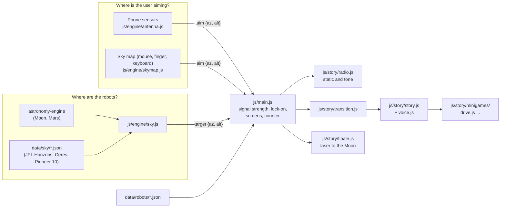
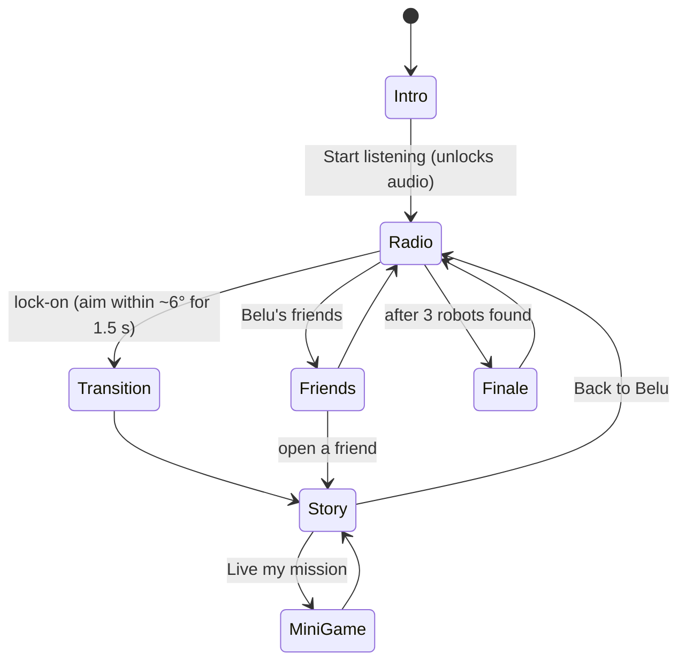

# Echo Station – Architecture

Echo Station is a **static web app**: plain HTML, CSS and JavaScript, with no server and no build step.
Kids help **Belu the beluga** find his friends: the robots NASA left on the Moon, on Mars and beyond.
Belugas find their way with echoes, so the phone becomes Belu's echolocation: kids point it at the **real sky**,
find each robot, hear its story, add it as a friend and help it relive its mission.
Belu is a fictional character; every fact about the robots is real.

---

## 1. Tech stack

| Layer | Technology | Why |
|---|---|---|
| Structure | **HTML5** (`index.html`, one page, several screens) | Opens on any browser, no install |
| Style | **CSS3** (variables, media queries, `prefers-reduced-motion`) | Theme in one place (`:root` variables) |
| Logic | **JavaScript (ES modules)**, vanilla, no framework | No build step, fast on cheap phones, anyone can contribute |
| Content & data | **JSON** (`data/robots/*.json`, `data/sky/*.json`) | Adding a robot means adding a file, not changing code |
| Data tool | **Python 3** (`tools/horizons_to_json.py`) | Exports NASA JPL Horizons ephemerides once, offline |
| Astronomy | **astronomy-engine 2.1.19** (MIT, vendored in `js/lib/`) | Real positions and distances of the Moon and Mars |
| Hosting | **GitHub Pages** (static, HTTPS) | Free, public link for the judges, HTTPS is required for phone sensors |

**Browser APIs used:** DeviceOrientation (with the iOS permission request), Geolocation, Web Audio API, Canvas 2D, `fetch`, `matchMedia`.

**NASA data used:** NASA JPL Horizons (sky positions and distances), NSSDCA (mission records), LRO/LROC, MRO/HiRISE, Mars 2020 and Dawn images, NASA audio.

---

## 2. Big picture



**In one sentence:** the antenna (or the sky map) says *where the user aims*, `sky.js` says *where the robots really are*,
and `main.js` compares the two to decide how strong the signal is and when to open a robot's story.

---

## 3. Folder structure

```
Echo_Station/
├── index.html              One page; each screen is a <section> (intro, radio, story, mini-game, finale)
├── css/style.css           Theme (:root colours) + all styles
├── js/
│   ├── main.js             Entry point: loads data, connects the modules, manages screens
│   ├── lib/
│   │   └── astronomy.browser.min.js   astronomy-engine (MIT)
│   ├── engine/             Dev A: the sky and the antenna
│   │   ├── sky.js          Real positions (+ distances / light-time) of every target
│   │   ├── antenna.js      Phone orientation → direction of the back camera, smoothing, calibration
│   │   ├── guide.js        Guidance arrow ("turn left", "aim higher")
│   │   └── skymap.js       Draggable sky map for computers and phones without sensors
│   └── story/              Dev B: what the user sees and hears
│       ├── radio.js        Web Audio: static, tone and Belu's echolocation clicks, shared AudioContext
│       ├── voice.js        Robot voices (mp3) + automatic subtitles
│       ├── story.js        Story screen: typed text, photo, questions, sources, "add as a friend"
│       ├── friends.js      Belu's friends: collection saved in the browser + friend cards
│       ├── transition.js   Static → "SIGNAL ACQUIRED" → story
│       ├── finale.js       Laser to the Apollo 11 mirror (real round-trip time)
│       └── minigames/
│           ├── index.js    Registry of mini-game templates
│           └── drive.js    "Drive" template (Spirit and its stuck wheel)
├── data/
│   ├── robots/             Content: one JSON file per robot + index.json (the list)
│   └── sky/                Sky tables exported from JPL Horizons
├── assets/
│   ├── images/             Real NASA images (with credits) + belu-neutral/happy/sad.svg (mascot)
│   └── audio/              Robot voices: <robot-id>.mp3
├── tools/
│   └── horizons_to_json.py Exports positions + distances from NASA JPL Horizons
└── docs/                   Team briefs and code snippets
```

---

## 4. Screens and user flow



Each screen is a `<section class="screen">` in `index.html`. `main.js` shows one at a time with `show(id)`.

---

## 5. Modules and responsibilities

| Module | Main exports | Role |
|---|---|---|
| `main.js` | (entry point) | Loads robots and sky tables, receives the aim, computes the signal, triggers lock-on, animates Belu, manages screens, the friends button and the finale unlock |
| `engine/sky.js` | `loadSkyTables`, `getHorizontal`, `angularDistance`, `getLightTime`, `formatLightTime` | Converts each target into azimuth/altitude for the user's location and time; Earth distance → light-time |
| `engine/antenna.js` | `enableAntenna`, `onPointing`, `calibrate`, `pointing` | Reads DeviceOrientation, computes where the back camera points, smooths it, applies the Moon calibration offset |
| `engine/guide.js` | `computeGuide` | Arrow angle and hint text towards the nearest robot not found yet |
| `engine/skymap.js` | `initSkyMap` | Canvas view of the real sky; its centre is sent as the aim, exactly like the antenna |
| `story/radio.js` | `startRadio`, `setSignal`, `muteRadio`, `getAudioContext` | Static noise that fades as the tone rises; echolocation clicks that speed up with the signal |
| `story/friends.js` | `addFriend`, `isFriend`, `countFriends`, `renderFriends` | Belu's friend collection (localStorage, `?reset` to start over) and the friend cards |
| `story/voice.js` | `playVoice`, `stopVoice`, `buildCues` | Plays `assets/audio/<id>.mp3` if it exists; builds subtitles from `voice_text` |
| `story/story.js` | `showStory`, `stopStory`, `skipTyping` | Renders a robot: greeting to Belu, typed story (5 parts), "add as a friend", photo, human touch, questions, sources |
| `story/transition.js` | `playTransition` | ~1.8 s noise that clears up + lock chirp + "ECHO RECEIVED" + robot name |
| `story/minigames/*` | `startMinigame` → `{ stop }` | Mini-game templates chosen by `robot.minigame.type` |
| `story/finale.js` | `openFinale` | Laser animation; waiting time = real Earth–Moon round trip right now |

---

## 6. How the antenna works

1. **Where the phone points.** DeviceOrientation gives three angles (alpha, beta, gamma). `pointing()` turns them into the direction of the back camera: azimuth (0° = North) and altitude (0° = horizon). On iPhone, `webkitCompassHeading` gives the compass heading.
2. **Smoothing.** The direction is smoothed as a 3D vector (not as angles), so 359° → 0° does not cause a jump.
3. **Calibration.** Phone compasses are off by 10–20°. The user aims at the Moon, which is visible and computed exactly, and taps *Calibrate*. The offset is applied to every target.
4. **Where the robots are.** `sky.js` gets the Moon and Mars from astronomy-engine, and Ceres and Pioneer 10 from the JPL Horizons tables, then converts them to azimuth/altitude for the user's latitude, longitude and time.
5. **Signal and lock-on.** `strength = 1 − distance / TOLERANCE_DEG`. When the strength stays above `LOCK_LEVEL` for `LOCK_TIME_MS`, the robot is locked (about 6° with the recommended values: 20, 0.7, 1500). These constants are at the top of `main.js`.
6. **Without sensors.** The sky map sends its centre as the aim, so everything else works the same.

---

## 7. Data model

**Robot** (`data/robots/<id>.json`, listed in `data/robots/index.json`):

```json
{
  "id": "spirit",
  "name": "Spirit",
  "type": "rover",
  "body": "mars",
  "site": "Gusev Crater",
  "launched": "2003-06-10",
  "landed": "2004-01-04",
  "last_signal": "2010-03-22",
  "status": "silent",
  "sky_target": "mars",
  "story": { "who_i_am": "…", "why_sent": "…", "discoveries": "…", "where_now": "…", "legacy": "…" },
  "human_touch": "…",
  "greeting": "Optional first words to Belu (default: Hello Belu… you found me!)",
  "voice_text": "Exact text of the recorded voice (used for subtitles)",
  "questions": [{ "q": "…", "a": "…" }],
  "proof_image": { "file": "assets/images/…", "caption": "…", "credit": "…", "source_url": "…" },
  "minigame": { "type": "drive", "settings": { … }, "intro": "…", "hint": "…", "success": "…" },
  "sources": [{ "title": "…", "url": "…" }]
}
```

- Dates are in **UTC** (`YYYY-MM-DD`).
- `sky_target` is one of `moon`, `mars`, `ceres`, `pioneer10`. Several robots can share a target: they are found one after the other.
- Every fact must come from one of the `sources`.

**Sky table** (`data/sky/<target>.json`, made by `tools/horizons_to_json.py`):

```json
{ "target": "ceres", "source": "NASA JPL Horizons", "points": [
  { "t": "2026-11-01T00:00Z", "ra": 3.12345, "dec": -12.3456, "dist_au": 1.9876 }
] }
```

`ra` is in hours, `dec` in degrees, `dist_au` is the Earth–target distance. `sky.js` interpolates between points.

---

## 8. Audio

Browsers (especially iPhone) only allow sound after a tap. The **Start listening** button creates a single Web Audio `AudioContext`
(`radio.js`), and every sound reuses it: static, voices, transition chirp, laser and echo. That is why voices can start
automatically when a robot is found.

---

## 9. Design choices

- **Accessibility.** Keyboard control of the sky map and the mini-game, screen readers get the full story text at once
  (the typing animation is hidden from them), subtitles for every voice, a shorter version of every animation when
  `prefers-reduced-motion` is on, no fast flashing, and touch targets of at least 44 px.
- **Performance.** No framework, sky positions recomputed every 10 s (not 60 times a second), low-resolution noise
  scaled by CSS, everything static and cacheable.
- **Honesty.** Real positions, real distances, real NASA images with credits. Belu is clearly presented as a fictional
  character, and the laser finale says it is a simulation based on the real Earth–Moon distance.
- **The mascot.** Belu ties the story together: belugas really use echolocation, the robots are found with "echoes",
  and the finale shows that scientists also listen to echoes (the laser bouncing back from the Apollo 11 mirror).
- **Debugging.** Add `?debug` to the URL for the raw sensor values, or `?finale` to jump to the finale (useful for filming).

---

## 10. Extending the project

| To add… | Do this |
|---|---|
| A robot | Create `data/robots/<id>.json`, add `<id>` to `index.json`, add its image and voice in `assets/` |
| A new sky target | Add it to `TARGETS` in `tools/horizons_to_json.py`, run the script, use the name as `sky_target` |
| A mini-game | Create `js/story/minigames/<type>.js` exporting `start(robot, ui)` → `{ stop }`, register it in `minigames/index.js` |
| A language | Add translated fields to the robot JSON files (planned: French and Arabic) |

When a NASA mission ends (Curiosity, Voyager…), it only takes one JSON file to add it to the station.

---

## 11. Run and deploy

```bash
# Local test (the app loads JSON files, so it needs a local server)
python -m http.server 8000      # then open http://localhost:8000

# Refresh the sky tables (needs internet)
python tools/horizons_to_json.py

# Deploy: every push to main is published by GitHub Pages in 1–2 minutes
git add . && git commit -m "…" && git push
```

Phone sensors only work over HTTPS: test the antenna on the GitHub Pages URL, not on `localhost` from the phone.

---

## 12. Credits

- astronomy-engine © Don Cross, MIT License.
- Images and sounds: NASA and partner institutions (see each robot's `proof_image.credit` and `sources`).
- AI use: parts of the code skeleton and modules were drafted with Claude (Anthropic), then reviewed, tested and adapted by the team.
